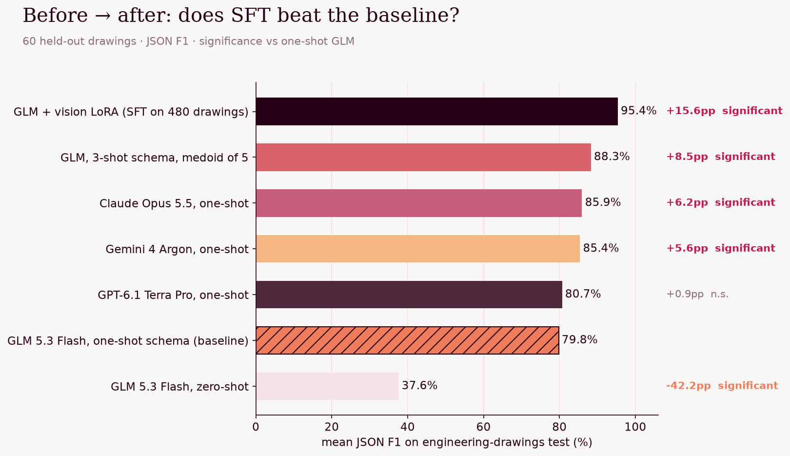
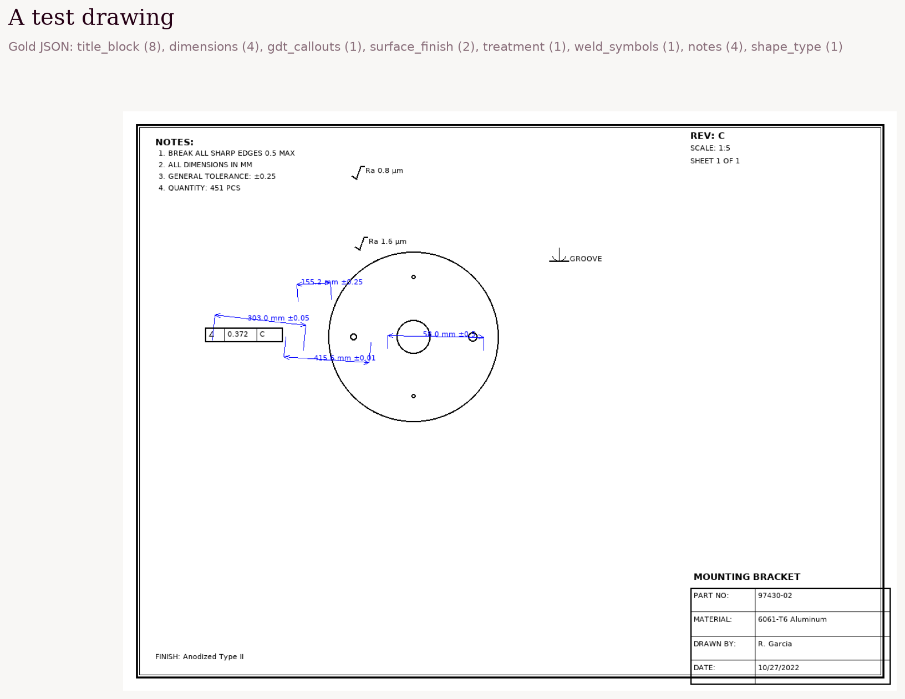
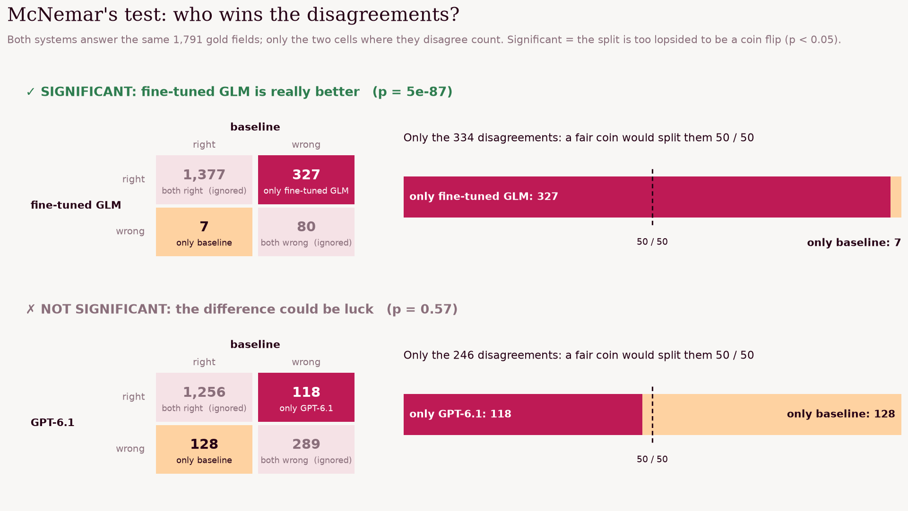
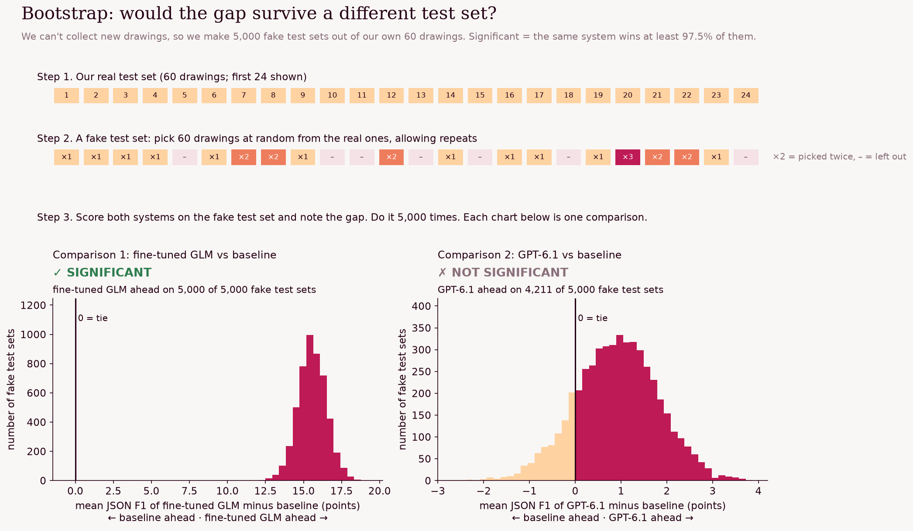
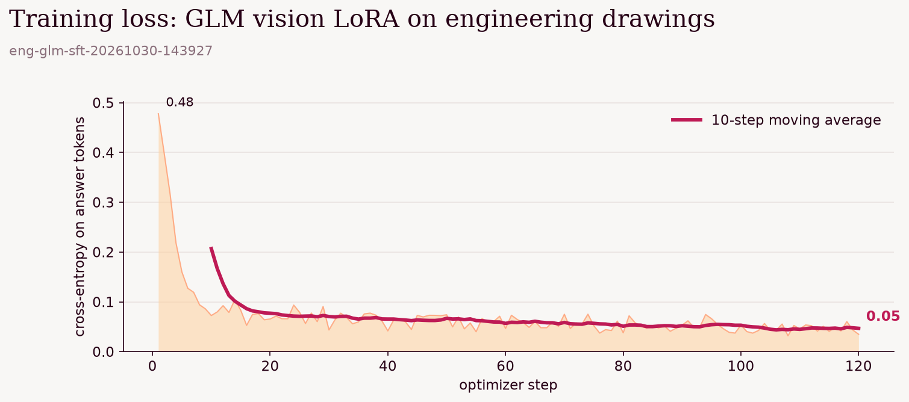
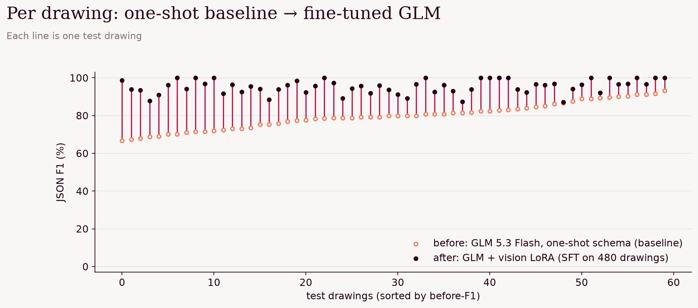

# Engineering drawings → JSON

Can a small open vision model extract everything a machinist needs from a 2D engineering drawing (title block,
dimensions and tolerances, GD&T callouts, surface finish, treatment, weld symbols, notes) as structured JSON? We start
from GLM 5.3 Flash, improve it with prompting, then with a vision LoRA fine-tune, and test every gain for
statistical significance.

**Result:** both worked. A 3-shot prompt took GLM from 79.8% to 88.2% JSON F1 (+8.4 points); fine-tuning took it to
95.4% (+15.6). The fine-tuned GLM beats every frontier model we tried by 9–15 points, all significant.

## Data

[`ecado/rfq-engineering-drawings`](https://huggingface.co/datasets/ecado/rfq-engineering-drawings): 600 drawings with
gold JSON. They look synthetic (clean renders, generated names and dates).

| Split | Drawings | Gold fields | Use |
| --- | --- | --- | --- |
| train | 480 | 18,030 | fine-tuning data and prompt examples |
| validation | 60 | 2,284 | development |
| **test** | **60** | **2,163** | sealed evaluation |

**Metric: JSON F1.** The output must be valid JSON; then F1 over `(key path, value)` leaf pairs against the gold,
ignoring list order. Every model gets the dataset's own instruction and images ≤1200 px.

**Baseline.** Zero-shot, GLM invents its own key names (`part_name`, `part_no`) and scores 37.6%, which measures the
schema rather than the reading. So the baseline is GLM with a **one-shot schema prompt**: one training drawing's gold
JSON as the exact output format. Every frontier model gets the same prompt.

## Results

| System | JSON F1 | vs baseline | $ per 1,000 drawings |
| --- | --- | --- | --- |
| **GLM 5.3 Flash + vision LoRA** | **95.4%** | **+15.6, significant** | not measured (scored inside the training session) |
| GLM, 3-shot schema, medoid of 5 | 88.3% | +8.5, significant | $2.30 |
| GLM, 3-shot schema | 88.2% | +8.4, significant | $0.46 |
| Claude Opus 5.5, one-shot | 85.9% | +6.2, significant | $16.20 |
| Gemini 4 Argon, one-shot | 85.4% | +5.6, significant | $5.56 |
| Muse Spark, one-shot | 84.7% | +4.9, significant | $5.24 |
| Kimi K3, one-shot | 84.0% | +4.2, significant | $13.23 |
| GPT-6.1 Terra Pro, one-shot | 80.7% | +0.9, not significant | $9.13 |
| GLM 5.3 Flash, one-shot schema (baseline) | 79.8% | | $0.39 |
| GLM 5.3 Flash, zero-shot | 37.6% | −42.2, significant | $0.41 |

### How we decide a difference is real

A model can beat another on one test set just by luck. We use two standard checks, and call a difference real only if
it passes both.

**1. McNemar's test: who wins the disagreements?** We break every test drawing into its gold fields (1,791 across the
60 drawings, e.g. `title_block.material = 6061-T6 Aluminum`) and check, for each system, whether it got each field.
Fields both systems got, or both missed, say nothing about which is better, so we ignore them and look only at the
fields exactly one of them got. If the two were equally good, those would split roughly 50 / 50, like a coin flip.
McNemar's test asks how lopsided the split is, and how likely that would be by pure chance (the p-value; we need
under 5%).

The fine-tune wins 327 of its 334 disagreements with the baseline: nothing like a coin flip. GPT-6.1 vs the baseline
splits 118 / 128, which could easily be luck.

**2. Bootstrap: would the gap survive a different test set?** We can't collect new drawings, so we fake new test sets
from the ones we have: draw 60 drawings from our 60 at random, *with replacement* (some get picked twice, some not at
all), and compute both systems' mean JSON F1 on that fake set. Repeat 5,000 times. If the same system comes out ahead in at least 97.5% of those fake test sets, the gap is real.

In each chart, every bar counts fake test sets; the black line is a tie. The fine-tune beats the baseline on all
5,000 (left). GPT-6.1 is ahead on 4,211 but behind on 789 (right), too often to call it a real win.

Why both? McNemar is powerful because it has 1,791 fields to work with, but it has two blind spots: it only counts
fields a system *found*, so inventing extra wrong fields isn't penalised, and it treats fields as independent when one
misread drawing can sink a whole block of them. The bootstrap fixes both: it uses the full F1 score (which does
penalise invented fields) and resamples whole drawings. GPT-6.1 shows the difference: it finds slightly *fewer* gold
fields than the baseline (118 vs 128), yet its F1 is 0.9 points higher because it invents fewer wrong ones. Neither
difference is significant. The two tests agreed on every comparison below.

The exact formulation

- **Gold fields.** A field is one distinct `key path = value` leaf of a drawing's gold JSON; exact duplicates within a
  drawing are merged, which is why there are 1,791 fields rather than 2,163.
- **Exact McNemar.** Let *b* = fields only A got, *c* = fields only B got. Under the null hypothesis that A and B are
  equally good, *b* ~ Binomial(*b* + *c*, ½), and the two-sided p-value is
  p = min(1, 2 · P(X ≤ min(*b*, *c*))), X ~ Binomial(*b* + *c*, ½). We use the exact binomial form rather than the χ²
  approximation because some comparisons have few disagreements (fine-tune vs best harness: 145 vs 5).
- **Drawing bootstrap.** Each of 5,000 replicates draws 60 test drawings with replacement and computes
  Δ = mean F1(A) − mean F1(B). The 95% confidence interval is the 2.5th to 97.5th percentile of the 5,000 values of Δ;
  it must exclude zero.
- Significant means both: McNemar p < 0.05 **and** the bootstrap interval excludes zero.

| Comparison | Gap | Fields only A / only B right | McNemar p | Drawing bootstrap 95% CI |
| --- | --- | --- | --- | --- |
| 3-shot vs baseline | +8.4 | 206 / 26 | 6e-36 | [+6.7, +10.0] |
| Fine-tune vs baseline | +15.6 | 327 / 7 | 5e-87 | [+13.7, +17.4] |
| Fine-tune vs best harness | +7.1 | 145 / 5 | 9e-37 | [+6.0, +8.1] |
| Fine-tune vs Claude Opus 5.5 | +9.4 | 224 / 55 | 2e-25 | [+7.5, +11.3] |
| Fine-tune vs Gemini 4 Argon | +10.0 | 223 / 58 | 6e-24 | [+8.3, +11.6] |
| Fine-tune vs GPT-6.1 Terra Pro | +14.7 | 369 / 39 | 2e-68 | [+12.7, +16.6] |

### Prompting helped

Three training drawings, chosen to cover as many distinct keys as possible, as worked examples instead of one. That
pins down the output schema better for almost no extra cost. Sampling 5 answers and keeping the medoid (the one that
agrees most with the others) added nothing on top, at 5× the cost.

### Fine-tuning helped more

All 480 training drawings, each `[drawing, instruction] → compact gold JSON`. Serverless vision LoRA on Fireworks:
rank 16, learning rate 1e-4, 2 epochs, batch 8 (120 steps). The tuned model gets only the instruction, with no schema
example.

It improved all 60 test drawings; 54 of them now score 90% or more.

The notebook promotes the adapter to a model in your Fireworks account, so it can be deployed afterwards.

## Caveats

- The drawings look synthetic and come from one generator, so train and test share a style. Expect a smaller gain on
  real shop drawings.
- Frontier models were tested with the one-shot prompt only, not the 3-shot harness.

## Run it

Run the notebooks in order; each one is cached, so re-running only fills in what's missing.

| Notebook | What it does | Cost |
| --- | --- | --- |
| [`01_baseline.ipynb`](01_baseline.ipynb) | Downloads the data; GLM zero-shot and one-shot, then Kimi, Muse, Gemini, Opus, GPT one-shot | ≈$3 |
| [`02_harness.ipynb`](02_harness.ipynb) | 3-shot schema prompt, alone and as medoid of 5 | ≈$0.20 |
| [`03_sft.ipynb`](03_sft.ipynb) | Vision LoRA fine-tune in the background, scoring, promotion, final charts | training run |

Needs `FIREWORKS_API_KEY` and `OPENROUTER_API_KEY` in the repo-root `.env`.

| File | What it does |
| --- | --- |
| `eng_common.py` | Data download, prompts, JSON F1 scoring, cached async eval |
| `eng_report.py` | Field-level McNemar, drawing bootstrap, leaderboard and per-drawing charts |
| `eng_sft.py` | The fine-tuning job (train, score test set, promote) |
| `fw_utils.py` | Background jobs, Fireworks cookbook setup, vision sampling prompts, plot styling |
