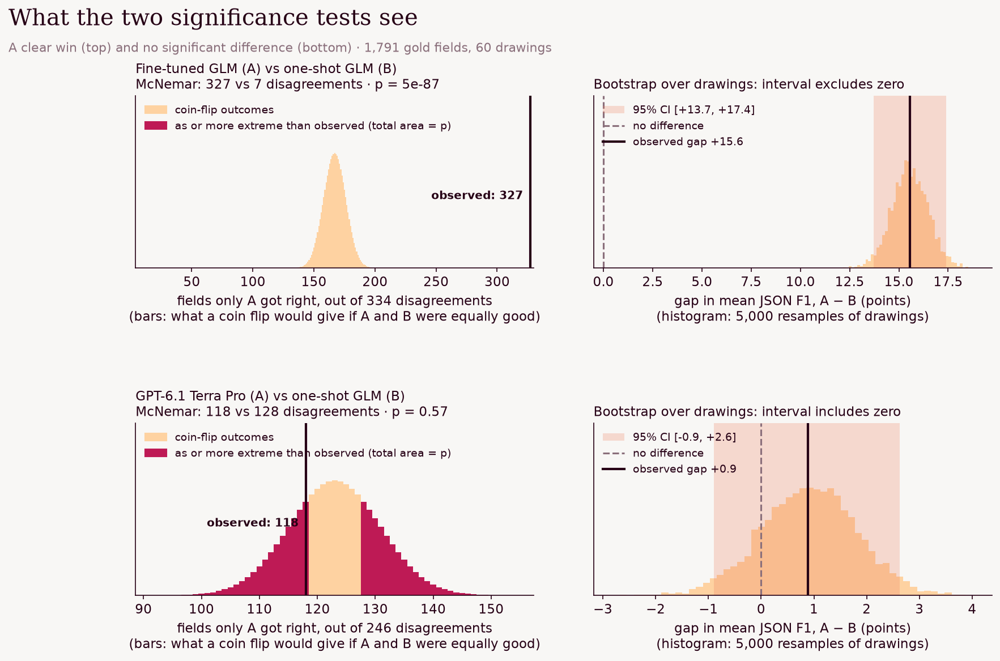

# Engineering drawings → JSON

Can a small open vision model extract everything a machinist needs from a 2D engineering drawing (title block,
dimensions and tolerances, GD&T callouts, surface finish, treatment, weld symbols, notes) as structured JSON? We start
from GLM 5.3 Flash, improve it with prompting, then with a vision LoRA fine-tune, and test every gain for
statistical significance.

**Result:** both worked. A 3-shot prompt took GLM from 79.8% to 88.2% JSON F1 (+8.4 points); fine-tuning took it to
95.4% (+15.6). The fine-tuned GLM beats every frontier model we tried by 9–15 points, all significant.

## Data

[`ecado/rfq-engineering-drawings`](https://huggingface.co/datasets/ecado/rfq-engineering-drawings): 600 drawings with
gold JSON. They look synthetic (clean renders, generated names and dates).

| Split | Drawings | Gold fields | Use |
| --- | --- | --- | --- |
| train | 480 | 18,030 | fine-tuning data and prompt examples |
| validation | 60 | 2,284 | development |
| **test** | **60** | **2,163** | sealed evaluation |

**Metric: JSON F1.** The output must be valid JSON; then F1 over `(key path, value)` leaf pairs against the gold,
ignoring list order. Every model gets the dataset's own instruction and images ≤1200 px.

**Baseline.** Zero-shot, GLM invents its own key names (`part_name`, `part_no`) and scores 37.6%, which measures the
schema rather than the reading. So the baseline is GLM with a **one-shot schema prompt**: one training drawing's gold
JSON as the exact output format. Every frontier model gets the same prompt.

## Results

| System | JSON F1 | vs baseline | $ per 1,000 drawings |
| --- | --- | --- | --- |
| **GLM 5.3 Flash + vision LoRA** | **95.4%** | **+15.6, significant** | not measured (scored inside the training session) |
| GLM, 3-shot schema, medoid of 5 | 88.3% | +8.5, significant | $2.30 |
| GLM, 3-shot schema | 88.2% | +8.4, significant | $0.46 |
| Claude Opus 5.5, one-shot | 85.9% | +6.2, significant | $16.20 |
| Gemini 4 Argon, one-shot | 85.4% | +5.6, significant | $5.56 |
| Muse Spark, one-shot | 84.7% | +4.9, significant | $5.24 |
| Kimi K3, one-shot | 84.0% | +4.2, significant | $13.23 |
| GPT-6.1 Terra Pro, one-shot | 80.7% | +0.9, not significant | $9.13 |
| GLM 5.3 Flash, one-shot schema (baseline) | 79.8% | | $0.39 |
| GLM 5.3 Flash, zero-shot | 37.6% | −42.2, significant | $0.41 |

### How we decide a difference is real

There are only 60 test drawings, so a test on drawings alone has little power. But each drawing has dozens of gold
fields, and every system is scored against the same ones, so the comparisons are **paired**. We call a difference
significant only if it passes **two** tests at α = 0.05: one on fields, for power, and one on drawings, for honesty
about correlation and about the metric we actually report.

**1. Exact McNemar test (per gold field).** A gold field is one distinct `key path = value` leaf of a drawing's gold
JSON. There are 1,791 across the 60 test drawings, after merging exact duplicates within a drawing. For each field and
each system: did the output contain that exact pair? Fields both systems got, or both missed, say nothing about which
is better; only the disagreements do. Let *b* = fields only A got and *c* = fields only B got. If the systems were
equally good, each disagreement would be a coin flip, so under the null hypothesis *b* ~ Binomial(*b* + *c*, ½), and

  p = min(1, 2 · P(X ≤ min(*b*, *c*))), X ~ Binomial(*b* + *c*, ½)

We use the exact binomial form, not the χ² approximation, because some comparisons have few disagreements (the
fine-tune vs the best harness: 145 vs 5).

McNemar on fields has two blind spots. It measures **recall** only: a system that adds invented fields isn't
penalised, while F1 is. And it treats fields as independent, which they aren't: one misread drawing, or one wrong key
name, can sink a whole block of fields at once.

**2. Drawing-level bootstrap (on mean JSON F1).** This covers both. For each drawing we have F1(A) and F1(B); each of
5,000 replicates draws 60 drawings with replacement and recomputes the mean F1 gap Δ = mean F1(A) − mean F1(B). The 95%
confidence interval is the 2.5th to 97.5th percentile of those gaps, and it must exclude zero. It's on the headline
metric, precision included, and it treats each drawing (with all of its correlated fields) as one unit.

Both tests agreed on every comparison below.

How to read it: each row is one comparison. **Left (McNemar):** the bars are what a coin flip would give for the
number of fields only A got right, if A and B were equally good; the black line is what actually happened. For the
fine-tune (top) it is 327 of 334 disagreements, off the chart for a coin flip. **Right (bootstrap):** the histogram is
the mean-F1 gap across 5,000 resamples of drawings, and the shaded band is the 95% interval; it has to clear zero.

The bottom row shows why both tests are needed. GPT-6.1 recovers slightly *fewer* gold fields than the baseline (118
vs 128), yet its mean F1 is 0.9 points higher, because it adds fewer wrong fields: precision, which McNemar can't see.
Neither difference is significant.

| Comparison | Gap | Fields only A / only B right | McNemar p | Drawing bootstrap 95% CI |
| --- | --- | --- | --- | --- |
| 3-shot vs baseline | +8.4 | 206 / 26 | 6e-36 | [+6.7, +10.0] |
| Fine-tune vs baseline | +15.6 | 327 / 7 | 5e-87 | [+13.7, +17.4] |
| Fine-tune vs best harness | +7.1 | 145 / 5 | 9e-37 | [+6.0, +8.1] |
| Fine-tune vs Claude Opus 5.5 | +9.4 | 224 / 55 | 2e-25 | [+7.5, +11.3] |
| Fine-tune vs Gemini 4 Argon | +10.0 | 223 / 58 | 6e-24 | [+8.3, +11.6] |
| Fine-tune vs GPT-6.1 Terra Pro | +14.7 | 369 / 39 | 2e-68 | [+12.7, +16.6] |

### Prompting helped

Three training drawings, chosen to cover as many distinct keys as possible, as worked examples instead of one. That
pins down the output schema better for almost no extra cost. Sampling 5 answers and keeping the medoid (the one that
agrees most with the others) added nothing on top, at 5× the cost.

### Fine-tuning helped more

All 480 training drawings, each `[drawing, instruction] → compact gold JSON`. Serverless vision LoRA on Fireworks:
rank 16, learning rate 1e-4, 2 epochs, batch 8 (120 steps). The tuned model gets only the instruction, with no schema
example.

It improved all 60 test drawings; 54 of them now score 90% or more.

The notebook promotes the adapter to a model in your Fireworks account, so it can be deployed afterwards.

## Caveats

- The drawings look synthetic and come from one generator, so train and test share a style. Expect a smaller gain on
  real shop drawings.
- Frontier models were tested with the one-shot prompt only, not the 3-shot harness.

## Run it

Run the notebooks in order; each one is cached, so re-running only fills in what's missing.

| Notebook | What it does | Cost |
| --- | --- | --- |
| [`01_baseline.ipynb`](01_baseline.ipynb) | Downloads the data; GLM zero-shot and one-shot, then Kimi, Muse, Gemini, Opus, GPT one-shot | ≈$3 |
| [`02_harness.ipynb`](02_harness.ipynb) | 3-shot schema prompt, alone and as medoid of 5 | ≈$0.20 |
| [`03_sft.ipynb`](03_sft.ipynb) | Vision LoRA fine-tune in the background, scoring, promotion, final charts | training run |

Needs `FIREWORKS_API_KEY` and `OPENROUTER_API_KEY` in the repo-root `.env`.

| File | What it does |
| --- | --- |
| `eng_common.py` | Data download, prompts, JSON F1 scoring, cached async eval |
| `eng_report.py` | Field-level McNemar, drawing bootstrap, leaderboard and per-drawing charts |
| `eng_sft.py` | The fine-tuning job (train, score test set, promote) |
| `fw_utils.py` | Background jobs, Fireworks cookbook setup, vision sampling prompts, plot styling |
