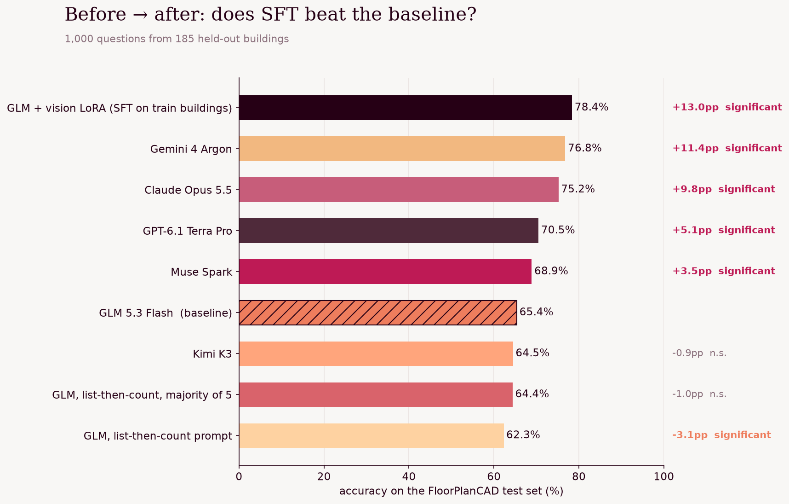
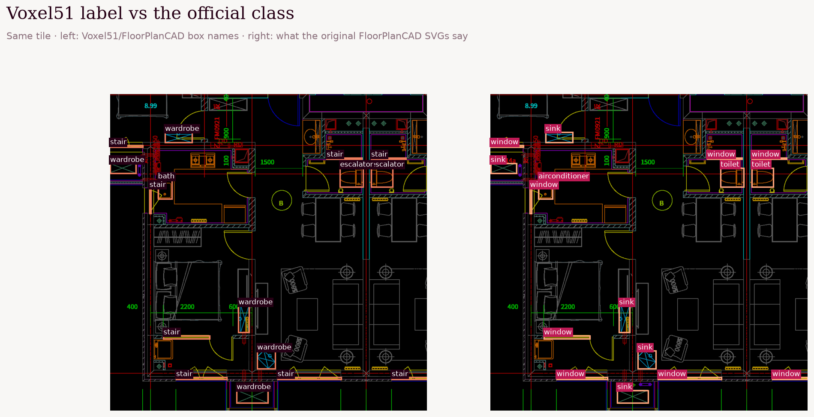
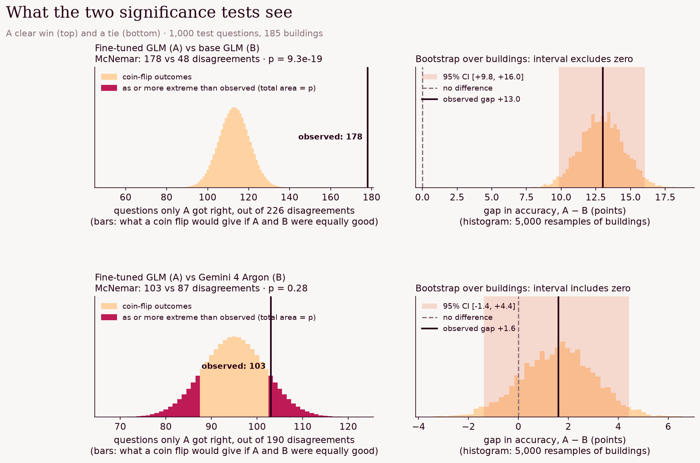
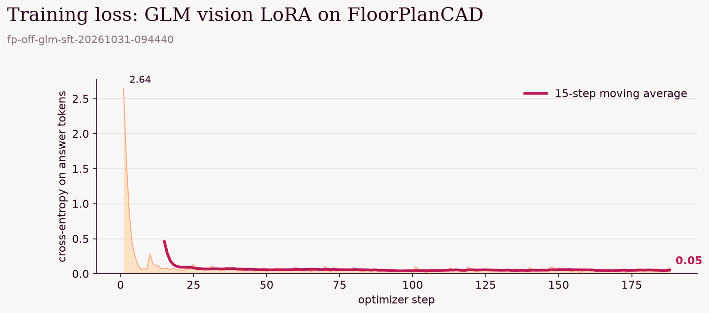
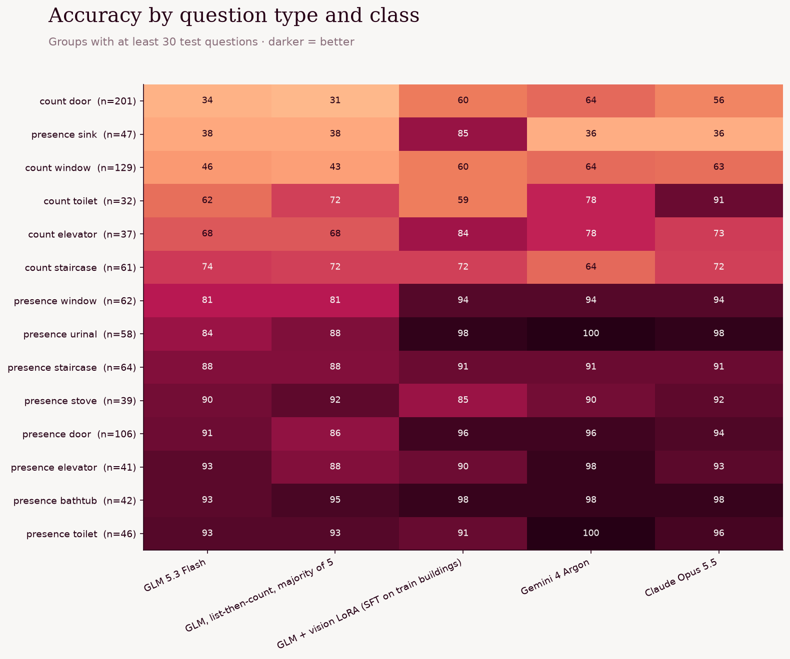

# FloorPlanCAD: counting symbols on real CAD floor plans

Can a small open vision model learn to read architectural drawings better than frontier models? We ask GLM 5.3 Flash
to count doors, windows, sinks, toilets and other symbols on real CAD floor plans, try to improve it with prompting
and then with a vision LoRA fine-tune, and test every gain for statistical significance.

**Result:** prompting made GLM worse; fine-tuning took it from 65.4% to 78.4% (+13.0 points, significant).
The fine-tuned GLM is significantly ahead of Claude Opus 5.5 and GPT-6.1 Terra Pro, and statistically tied with
Gemini 4 Argon.

## Data

[FloorPlanCAD](https://floorplancad.github.io/) (Fan et al., [ICCV 2021](https://arxiv.org/abs/2105.07147)) is a set of
real CAD floor plans with every drawing element annotated by class. We use the 5,308 tiles (≈20 m × 20 m crops,
coloured line work on black) from 1,116 buildings that are mirrored on Hugging Face as
[`Voxel51/FloorPlanCAD`](https://huggingface.co/datasets/Voxel51/FloorPlanCAD).

**The Hugging Face copy has scrambled class names.** Its boxes sit on the right objects, but the names are wrong:
sinks are labelled `wardrobe`, toilets `escalator`, windows `stair`, staircases `parking`. The dataset card names the
35 class ids with a 30-name list that doesn't match the id scheme, which is also why some labels come out as
`class_31` … `class_35`. So we take the labels from the original dataset instead: every Voxel51 image is a
pixel-identical copy of a drawing in the official test set, and the official SVGs carry the class id and instance id
of every element. [`01_official_labels.ipynb`](01_official_labels.ipynb) does the matching.

We first tried repairing the names by eye from crops of each label. That got 6 of the 9 classes we use right; the
original files showed that the Voxel51 `window` boxes are really sliding doors, `bath` is air conditioners, and `sink`
is refrigerators. If you use the Voxel51 labels directly, check them against the official SVGs first.

**Task.** One counting question ("How many windows are shown in this floor plan?", answers 1–12) and one presence
question ("Does this floor plan contain any elevators?", balanced yes / no) per tile, over 9 classes: doors (all six
door types), windows (window, bay, blind), toilets (toilet, squat toilet), sinks, staircases, elevators, urinals,
stoves, bathtubs (bath, bath tub).

| Split | Questions | Buildings | Use |
| --- | --- | --- | --- |
| train | 6,219 | ≈930 | fine-tuning data (3,000 sampled) |
| **test** | **1,000** | **185** | 495 counting + 505 presence (49% yes) |

Buildings are split 80 / 20, so no building is in both splits. Score: exact match.

## Results

| System | Accuracy | Counting, exact | vs base GLM | Cost of the 1,000-question run |
| --- | --- | --- | --- | --- |
| **GLM 5.3 Flash + vision LoRA** | **78.4%** | **63.8%** | **+13.0, significant** | not measured (scored inside the training session) |
| Gemini 4 Argon | 76.8% | 63.2% | +11.4, significant | $3.48 |
| Claude Opus 5.5 | 75.2% | 61.2% | +9.8, significant | $10.10 |
| GPT-6.1 Terra Pro | 70.5% | 53.5% | +5.1, significant | $4.80 |
| Muse Spark | 68.9% | 52.5% | +3.5, significant | $3.22 |
| GLM 5.3 Flash (baseline) | 65.4% | 46.5% | | $0.23 |
| Kimi K3 | 64.5% | 46.1% | −0.9, not significant | $16.29 |
| GLM, list-then-count, majority of 5 | 64.4% | 45.1% | −1.0, not significant | $1.53 |
| GLM, list-then-count prompt | 62.3% | 42.6% | −3.1, significant loss | $0.30 |

### How we decide a difference is real

Every system answers the same 1,000 questions, so each comparison is **paired**: for each question we know whether
system A was right and whether system B was right. We call a difference significant only if it passes **two** tests
at α = 0.05, because each one covers a weakness of the other.

**1. Exact McNemar test (per question).** Questions both systems got right, or both got wrong, say nothing about which
is better; only the disagreements do. Let *b* = questions only A got right and *c* = questions only B got right. If the
two systems were equally good, each disagreement would be a coin flip, so under the null hypothesis
*b* ~ Binomial(*b* + *c*, ½). The two-sided p-value is

  p = min(1, 2 · P(X ≤ min(*b*, *c*))), X ~ Binomial(*b* + *c*, ½)

We use the exact binomial form rather than the χ² approximation, because some comparisons have few disagreements.
McNemar is the right test for paired right / wrong outcomes and uses the full question-level detail, but it assumes
the questions are independent. They aren't quite: one tile yields two questions, and a building contributes many
tiles drawn in the same style (same CAD layers, same symbol library), so a model that misreads one building's door
symbol misreads all of them. Treating those as independent overstates the evidence.

**2. Building-level cluster bootstrap (on the accuracy gap).** To account for that, we resample whole buildings, the
unit of the train / test split, instead of questions. With 185 test buildings, each of 5,000 replicates draws 185
buildings with replacement, pools all of their questions, and recomputes the accuracy gap
Δ = accuracy(A) − accuracy(B). The 95% confidence interval is the 2.5th to 97.5th percentile of those 5,000 gaps; it
must exclude zero. Correlated questions move together inside a building, so this interval is wider, and more honest,
than one built from independent questions.

A gain that passes McNemar but not the bootstrap is likely driven by a handful of buildings. In practice the two
agreed on every comparison below.

How to read it: each row is one comparison. **Left (McNemar):** the bars are what a coin flip would give for the
number of questions only A got right, if A and B were equally good. The black line is what actually happened. Against
base GLM (top) it lands far beyond anything a coin flip produces; against Gemini (bottom) it sits inside the bulk, and
the magenta area, the chance of a result at least that lopsided, is 28%. **Right (bootstrap):** the histogram is the
accuracy gap across 5,000 resamples of buildings, and the shaded band is the 95% interval. The top band is far from
zero; the bottom one straddles it.

| Comparison | Gap | Questions only A / only B right | McNemar p | Building bootstrap 95% CI |
| --- | --- | --- | --- | --- |
| Fine-tune vs base GLM | +13.0 | 178 / 48 | 9e-19 | [+9.8, +16.0] |
| Fine-tune vs best harness | +14.0 | 201 / 61 | 1e-18 | [+10.7, +17.2] |
| Fine-tune vs Gemini 4 Argon | +1.6 | 103 / 87 | 0.28 | [−1.4, +4.4] (tie) |
| Fine-tune vs Claude Opus 5.5 | +3.2 | 118 / 86 | 0.03 | [+0.3, +6.1] |
| Fine-tune vs GPT-6.1 Terra Pro | +7.9 | 151 / 72 | 1e-7 | [+5.0, +10.7] |
| List-then-count vs base GLM | −3.1 | 59 / 90 | 0.01 | [−5.5, −0.7] (loss) |

The lead over Opus is significant but small: the bootstrap interval only just clears zero.

### Prompting didn't help

The harness asked GLM to scan the plan in a 3×3 grid and list every matching symbol with its location before giving
the number, then repeated that with 5 samples and a majority vote. Listing made it significantly worse; voting
recovered most of the loss but never beat the plain prompt. The model's problem is seeing small symbols, not
reasoning about them.

### Fine-tuning did

3,000 training questions from the training buildings, each `[plan image, question] → one short sentence + the answer`.
Serverless vision LoRA on Fireworks: rank 16, learning rate 1e-4, 1 epoch, batch 16 (≈190 steps).

The biggest gain is on sinks (presence: 38% → 85%), where Gemini and Opus both score 36%: small basin symbols that
general models miss. Counting doors (34% → 60%), windows (46% → 60%) and elevators (68% → 84%) also improve a lot.
Gemini and Opus still count toilets better.

The notebook promotes the adapter to a model in your Fireworks account, so it can be deployed afterwards.

## Caveats

- Only the official **test** split is mirrored on Hugging Face, so both our train and test buildings come from it.
  The split is by building, so no tile, drawing or building is shared.
- The task (counting and presence questions) is ours. FloorPlanCAD's official task is panoptic symbol spotting on the
  vector drawings, so these numbers aren't comparable with published FloorPlanCAD results.
- A [community clean-up project](https://github.com/w243943/floorplancad-process) reports a small number of genuine
  annotation errors in the original data. We didn't correct those.

## Run it

Run the notebooks in order; each one is cached, so re-running only fills in what's missing.

| Notebook | What it does | Cost |
| --- | --- | --- |
| [`01_official_labels.ipynb`](01_official_labels.ipynb) | Downloads the official test archive (~2 GB), matches images, reads the SVG labels, builds the split | free |
| [`02_baseline.ipynb`](02_baseline.ipynb) | GLM, Muse, Kimi (Fireworks) and Gemini, GPT, Opus (OpenRouter) | ≈$40 |
| [`03_harness.ipynb`](03_harness.ipynb) | List-then-count prompt, alone and as a vote of 5 | ≈$2 |
| [`04_sft.ipynb`](04_sft.ipynb) | Vision LoRA fine-tune in the background (≈1–1.5 h), scoring, promotion, final charts | training run |

Needs `FIREWORKS_API_KEY` and `OPENROUTER_API_KEY` in the repo-root `.env`. `02` and `03` can run in parallel with `04`.

| File | What it does |
| --- | --- |
| `fp_common.py` | Data, official-label split, prompts, answer parsing, cached async eval |
| `fp_report.py` | McNemar, building bootstrap, leaderboard and per-class charts |
| `fp_sft.py` | The fine-tuning job (train, score test set, promote) |
| `fw_utils.py` | Background jobs, Fireworks cookbook setup, vision sampling prompts, plot styling |
