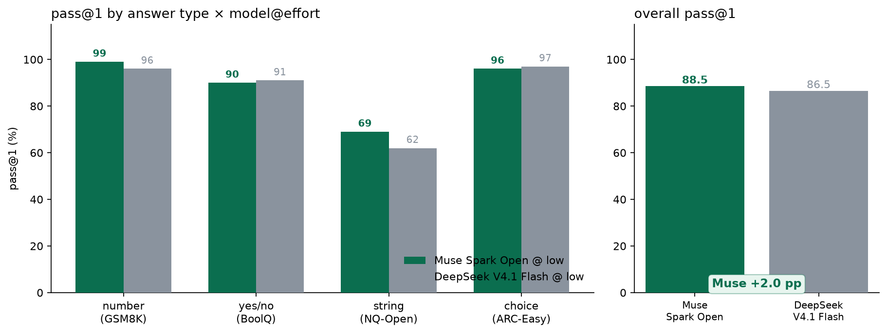
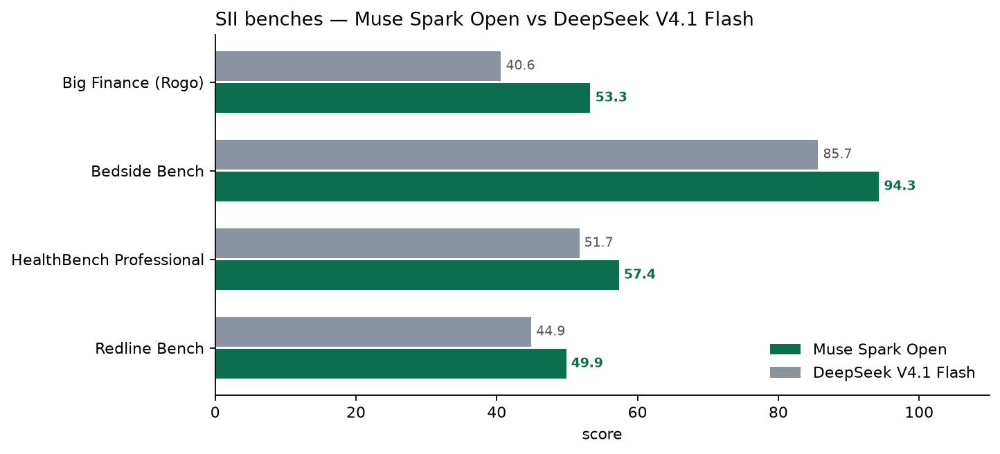
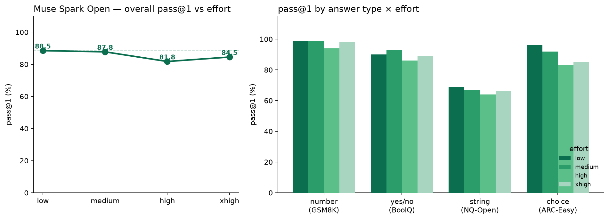
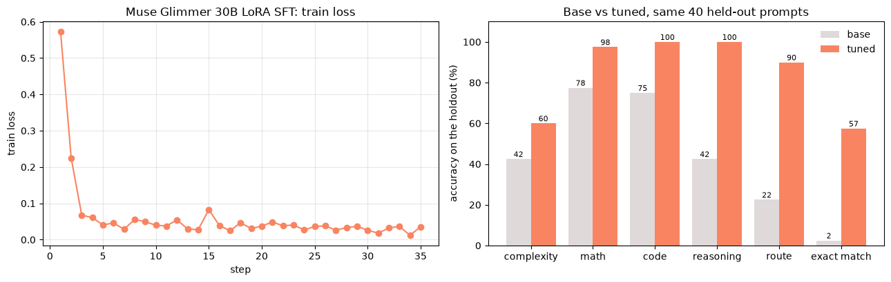

# Meta hackathon: Muse open models on Fireworks

Three notebooks for the Meta Global Hackathon workshop on Muse Spark Open and Muse Glimmer.

| Notebook | Question |
|---|---|
| `muse_vs_deepseek_demo.ipynb` | Does Muse Spark Open beat DeepSeek V4.1 Flash on simple short-answer text? |
| `muse_reasoning_sweep.ipynb` | Does more Muse reasoning effort help on those tasks? |
| `muse_glimmer_train_router.ipynb` | Can a fine-tuned Muse Glimmer decide which model a prompt should go to? |

## Short-answer suite (notebooks 1 and 2)

The four answer types mirror UiPad (number, yes/no, string, choice), but text only: no screenshots and no click coordinates.

| Answer type | Bench |
|---|---|
| number | GSM8K |
| yes/no | BoolQ |
| string | NQ-Open |
| choice | ARC-Easy |

Models run on Fireworks serverless. Grading is deterministic (number within 1%, yes/no match, string alias match, letter match). n=100 per bench.

### Muse vs DeepSeek — `muse_vs_deepseek_demo.ipynb`

Both models at `reasoning_effort=low`.

| Bench | Muse | DeepSeek | Δ |
|---|---:|---:|---:|
| GSM8K | **99.0** | 96.0 | +3.0 |
| NQ-Open | **69.0** | 62.0 | +7.0 |
| BoolQ | 90.0 | 91.0 | −1.0 |
| ARC-Easy | 96.0 | 97.0 | −1.0 |
| **Overall** | **88.5** | 86.5 | **+2.0** |



The notebook also plots published [Specialized Intelligence Index](https://fireworks.ai/specialized-intelligence-index/) results where Muse leads DeepSeek:



### Muse effort sweep — `muse_reasoning_sweep.ipynb`

Same suite, Muse only, across its full effort ladder (Muse does not accept `none`).

| Bench | low | medium | high | xhigh |
|---|---:|---:|---:|---:|
| GSM8K | **99** | **99** | 94 | 98 |
| BoolQ | 90 | **93** | 86 | 89 |
| NQ-Open | **69** | 67 | 64 | 66 |
| ARC-Easy | **96** | 92 | 83 | 85 |
| **Overall** | **88.5** | 87.8 | 81.8 | 84.5 |



On these easy tasks Muse peaks at `low`. Higher effort costs more tokens and lowers pass@1.

## Train Muse Glimmer as a router — `muse_glimmer_train_router.ipynb`

Fine-tunes Muse Glimmer 30B with LoRA SFT on [SupraLabs/Prompt-Routing-Dataset](https://huggingface.co/datasets/SupraLabs/Prompt-Routing-Dataset) (600 training prompts). Given a prompt, the tuned model returns JSON with `complexity`, `math`, `code`, `reasoning`, and `route`. The deployed router then sends prompts to DeepSeek V4.1 Flash (small route) or Muse Spark Open (big route).

Base vs tuned on 40 held-out prompts:

| Metric | Base | Tuned |
|---|---:|---:|
| Route accuracy | 22.5% | **90.0%** |
| Exact match (all fields) | 2.5% | **57.5%** |
| Unterminated answers | 6 | 0 |

Paired McNemar on exact match: 22 fixed, 0 broken, p = 4.8e-7. Training cost $0 under the promotion; evaluation sampling is billed per token.



Steps: build data locally from Hugging Face (no dataset upload), train with the Serverless Training API via the `fw-ai/cookbook` Muse Glimmer starter, deploy the tuned LoRA (`muse-router-demo`), route demo prompts, delete the deployment.

Training and deployment take too long to run live. Run them ahead of time, confirm the deployment is ready, then present from the routing step. Delete the deployment afterward; it bills per GPU-hour. LoRA SFT is free for jobs started before 2026-12-01 00:00 PT.

## Run it

`FIREWORKS_API_KEY` (and optionally `FIREWORKS_ACCOUNT_ID`) in the repo-root `.env`. Run notebooks with this folder as the working directory.

- Notebooks 1 and 2 share `results.jsonl`, which resumes. With `RUN_SWEEP = True` a full cache makes the sweep cell a no-op; set it to `False` to plot from the cache only.
- Notebook 3 needs [`firectl`](https://docs.fireworks.ai/tools-sdks/firectl/firectl) for deployment. It clones `cookbook/` and writes `data/router/` here.

From the command line:

```bash
python run_simple_bench.py --n 100 --efforts low
python run_simple_bench.py --summarize-only
```

## Files

| File | What it is |
|---|---|
| `run_simple_bench.py` | Short-answer suite: dataset sampling, Fireworks calls, grading |
| `results.jsonl` | Cached short-answer responses and scores |
| `MUSE_AHEAD.md`, `muse_ahead_*.png`, `simple_bench_low.png` | Extra slide assets |
